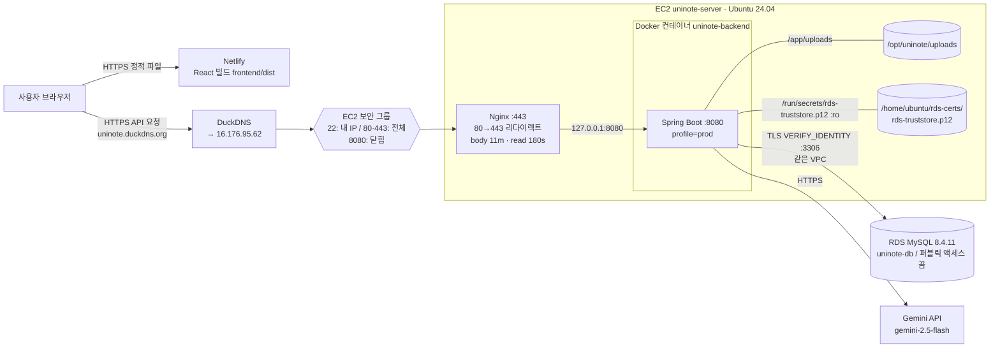
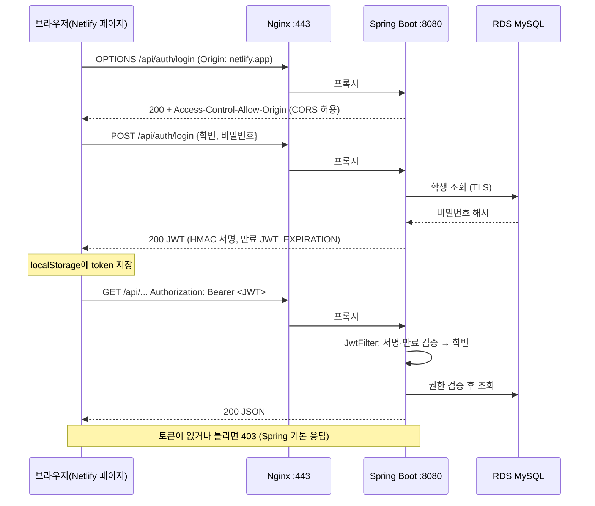

# UniNote AWS 배포환경 구축 및 운영 가이드

작성 기준일: 2026-11-07 · 기준 커밋: `origin/main` `4b98a4a` (2026-11-07 17:24 KST)

## 읽기 전에

- EC2·AWS 내용은 저장소 문서(`docs/1103.md`, `1104.md`, `1107.md`, `1107_1.md`, `current_problem.md`, `progress.md`, `배포환경 설계.md`), 작업 중 직접 실행한 결과, 작업자가 전달한 결과를 근거로 정리했다. EC2와 AWS 콘솔을 직접 조회해 만든 문서는 아니다.
- 실제 실행 기록이 없는 명령은 실행했다고 적지 않았다.
- 다음 항목은 기록이 없거나 확인되지 않아 "완료"로 적지 않았다.
  - 옛 JWT secret으로 만든 토큰이 거부되는지 테스트
  - `TZ` 설정
  - 퀴즈 데이터 건수 차이의 원인
  - Nginx의 `proxy_pass`, `proxy_send_timeout` 값
  - 실제로 실행한 scp·import 명령
- `docs/1107.md`와 `docs/current_problem.md`의 truststore 경로와 변수명은 2026-11-07에 EC2 기준으로 고쳤다. 두 파일에 적힌 truststore 경로는 처음 작성 당시의 원문이 아니다.
- 비밀값(비밀번호, `JWT_SECRET`, API 키, PEM 키, truststore 비밀번호)은 넣지 않았다.

### 출처 표기

| 표기 | 의미 |
|---|---|
| **[확인]** | 저장소 코드·git 이력, 또는 작업 중 직접 실행해 확인 |
| **[전달]** | 작업자가 실행하고 결과를 전달 |
| **[문서]** | 저장소 문서에 적힌 계획·절차. 그대로 실행했는지는 기록 없음 |
| **[일반]** | 일반적인 절차. 이 프로젝트에서 실행한 기록 없음 |
| **[미확인]** | 확인한 기록 없음 |

---

## 1. 프로젝트 및 배포환경 개요

| 구분 | 내용 |
|---|---|
| 저장소 | https://github.com/Jung-DaeYoung/uni-note (공개) |
| 브랜치 | 운영 `main`, 개발 `feature/note-ai` → PR로 main에 병합 |
| Backend | Java 21, Spring Boot 3.4.2, MySQL Connector/J 9.1.0 [확인] |
| Frontend | React 19, Vite, Netlify |
| DB | AWS RDS MySQL 8.4.11 (로컬은 MySQL 8.0.45) |
| 리전 | 시드니 `ap-southeast-2` |
| EC2 | `uninote-server`, t3.small(2 vCPU, 2GB RAM), Ubuntu 24.04 LTS, EBS 20GB gp3 |
| Elastic IP | `16.176.95.62` |
| 도메인 | `uninote.duckdns.org` (DuckDNS) |
| HTTPS | Nginx + Let's Encrypt(Certbot) |
| Frontend 주소 | https://earnest-hotteok-f6643f.netlify.app |
| Backend API 주소 | https://uninote.duckdns.org |

## 2. 전체 인프라 아키텍처

### 2-1. 전체 인프라 구조



### 2-2. 로그인 및 API 요청 흐름



---

## 3. 시간순 구축 과정 (STEP 1~22)

### STEP 1. AWS 계정 및 리전 (11-03 ~ 11-04)

- **목적**: AWS 리소스를 만들 계정과 리전을 정한다.
- **설정** [문서 1103·1104]
  - 개인 계정을 신규 가입(Free Plan)으로 만들면 연락처 국가에 따라 리전이 정해지고, 한국은 **시드니로 고정**된다.
  - 서울로 바꾸려면 유료 플랜 전환 후 advanced features 활성화(되돌릴 수 없음) 또는 계정 재생성이 필요하다. 이득이 적어 시드니를 그대로 쓴다.
- **당시 기록한 계정 정보** [문서 1104 · 기록 당시 기준이며 현재 상태가 아님]
  - Free Plan, 크레딧 $100, 미수금 $0.00
  - 무료 플랜 종료 예정일 2027-05-03
- **주의** [문서 1103]
  - 무료 플랜 계정은 6개월이 지나거나 크레딧을 다 쓰면 자동으로 닫히고, 90일 뒤 데이터가 삭제된다.
  - Elastic IP는 연결된 상태에서도 시간당 요금이 크레딧에서 빠진다.
  - 잔액은 Billing 콘솔에서 주기적으로 확인한다.
- **EC2와 RDS를 같은 리전·같은 VPC에 둔 이유**: 두 서버가 **AWS 내부의 사설 네트워크**로 통신한다. 그래서 지연이 적고, 데이터 전송 비용이 없거나 적으며, RDS를 인터넷에 공개할 필요가 없다.
- **통신 구조**: 인터넷 → EC2(공인 IP, 80·443) → 사설 IP로 RDS(3306). RDS에는 공인 경로가 없다.
- **현재 상태**: 완료 [전달]

### STEP 2. EC2 인스턴스 생성 (11-03 설정 → 11-04 완료)

- **설정** [문서 1103·1104]

| 항목 | 값 |
|---|---|
| 이름 | `uninote-server` |
| 유형 | t3.small (2 vCPU, 2GB RAM) |
| OS | Ubuntu Server 24.04 LTS |
| 스토리지 | EBS 20GB gp3 |
| 키 페어 | `uninote-key` → `C:\Users\DYJ\.ssh\uninote-key.pem` |
| 퍼블릭 IP | 활성화 → 이후 Elastic IP `16.176.95.62` 연결 |
| 보안 그룹 | `uninote-ec2-sg` (STEP 3) |

- **개념 설명**
  - **EC2를 고른 이유**: Docker 컨테이너 하나, Nginx, 인증서를 직접 다룰 수 있는 가장 단순한 서버다. ECS나 Kubernetes는 이 규모에서 과하다 [문서 progress].
  - **t3.small**:
    - "버스트형" 인스턴스다. 평소에는 기준 CPU 성능만 쓰다가, 모아 둔 CPU 크레딧으로 잠깐 더 높은 성능을 낸다.
    - 2GB RAM은 Spring Boot, Docker, Nginx를 함께 돌리기에 여유가 적다(STEP 20).
  - **Elastic IP**: 인스턴스를 중지했다 켜면 일반 공인 IP는 바뀐다. DuckDNS가 가리킬 **고정 IP**가 필요해서 쓴다.
  - **PEM 키**: SSH 로그인에 쓰는 개인키다. AWS는 공개키만 보관하므로, 파일을 잃어버리면 다시 받을 수 없다.
- **SSH 접속 명령**: 작업자가 전달한 PowerShell 명령이다. 1104 기록에는 처음에 CMD에서 OpenSSH의 **전체 경로**로 접속했다고 되어 있다.

  ```powershell
  ssh -i "$env:USERPROFILE\.ssh\uninote-key.pem" ubuntu@16.176.95.62
  ```

- **PEM 보관 수칙**
  - 저장소 폴더 밖에 둔다(현재 `%USERPROFILE%\.ssh`).
  - Git, 메신저, 클라우드 공유 폴더에 올리지 않는다.
  - 파일 권한을 본인 계정만 읽을 수 있게 제한한다. Windows에서 권한이 너무 열려 있으면 ssh가 `UNPROTECTED PRIVATE KEY` 오류로 거부한다.
  - 키가 유출되면 해당 키 페어를 교체한다.
- **현재 상태**: 완료 [전달]

### STEP 3. 보안 그룹 (11-03)

- **설정** [문서 1103·1104]

`uninote-ec2-sg` (EC2)

| 포트 | 프로토콜 | 접근 대상 | 목적 |
|---|---|---|---|
| 22 | TCP | 내 IP /32 | SSH |
| 80 | TCP | 0.0.0.0/0 | HTTP (HTTPS로 리다이렉트, Certbot 인증) |
| 443 | TCP | 0.0.0.0/0 | HTTPS |

`uninote-rds-sg` (RDS)

| 포트 | 프로토콜 | 접근 대상 | 목적 |
|---|---|---|---|
| 3306 | TCP | `uninote-ec2-sg` (보안 그룹 참조) | MySQL |

- **개념 설명**
  - **두 보안 그룹의 관계**: RDS 규칙이 "IP"가 아니라 "EC2 보안 그룹"을 허용한다. 그래서 그 보안 그룹이 붙은 인스턴스만 접속할 수 있다.
  - **IP 대신 보안 그룹을 참조하는 이유**: EC2를 다시 만들거나 IP가 바뀌어도 규칙을 고칠 필요가 없고, 다른 서버가 실수로 허용되지도 않는다.
  - **RDS를 공개하지 않는 이유**: DB 포트가 인터넷에 열려 있으면 비밀번호 대입 공격과 취약점 공격의 대상이 된다.
  - **8080을 공개하지 않는 이유**: 8080으로 직접 들어오면 HTTPS와 Nginx의 제한(업로드 크기, timeout)을 모두 건너뛴다. 모든 외부 요청은 Nginx 443을 거치게 한다.
    - Docker가 연 포트는 Ubuntu 방화벽(UFW)의 영향을 받지 않는다. 그래서 컨테이너 쪽도 `127.0.0.1:8080`으로만 연다(STEP 12).
- **실행 결과**: 외부 8080 차단을 확인했다(STEP 17) [전달].
- **현재 상태**: 완료

### STEP 4. DuckDNS 도메인 (11-03 생성, 11-04 연결)

- **목적**: HTTPS 인증서를 받으려면 도메인이 필요하다. Netlify 페이지가 HTTPS라 API도 HTTPS여야 브라우저가 막지 않는다(mixed content 차단).
  - Netlify 프록시로 우회하는 방법은 응답 제한이 약 26초라 AI 생성(최대 약 90초)이 실패한다. 그래서 쓰지 않았다 [문서 1103].
- **설정**: DuckDNS 웹에서 `uninote` 서브도메인을 만들고 current ip를 `16.176.95.62`로 지정했다 [문서 1104].
  - Elastic IP는 바뀌지 않으므로 DuckDNS IP 자동 갱신 cron은 쓰지 않는다.
- **확인 명령**: 1104에 `nslookup`으로 확인했다는 기록이 있다.

  ```bash
  nslookup uninote.duckdns.org   # Address: 16.176.95.62 이 나와야 함
  ```

- **도메인과 Elastic IP의 관계**: 도메인은 이름이고, DNS의 A 레코드가 이름을 IP로 바꿔 준다. IP가 고정이라 도메인 설정도 한 번만 하면 된다.
- **현재 상태**: 완료 [전달]

### STEP 5. RDS MySQL 생성 (11-07 이전)

- **설정** [전달 + 문서]

| 항목 | 값 |
|---|---|
| 식별자 | `uninote-db` |
| 엔진 | MySQL 8.4.11 |
| DB 이름 | `uninote_db` |
| 엔드포인트 | `uninote-db.cz2mg06mm9bk.ap-southeast-2.rds.amazonaws.com:3306` |
| 퍼블릭 액세스 | 끔 |
| 보안 그룹 | `uninote-rds-sg` |
| 8.4를 고른 이유 | RDS MySQL 8.0은 2026-07-31에 표준 지원이 끝나 추가 요금(Extended Support) 대상 [문서] |
| 인스턴스 클래스, 스토리지, Single-AZ 여부 | **[미확인]** |
| 자동 백업, 삭제 방지 | **[미확인]** (보류 항목) |
| 파라미터 그룹 `time_zone` | **[미확인]** |
| 앱 전용 DB 계정 사용 여부 | **[미확인]** |

- **개념 설명**
  - **EC2와 RDS를 분리한 이유**: 백업, 패치, 장애 복구를 AWS가 맡는다. 앱 서버를 다시 만들어도 데이터는 그대로 남는다.
  - **엔드포인트**: RDS에 접속할 때 쓰는 호스트명이다. 내부 IP는 바뀔 수 있으니 항상 이 이름으로 접속한다. 인증서 호스트명 검증도 이 이름을 기준으로 한다(STEP 11).
  - **DB 환경변수**: `DB_HOST`(엔드포인트), `DB_PORT`(3306), `DB_NAME`(uninote_db), `DB_USERNAME`·`DB_PASSWORD`(계정). 값은 `backend.env`에만 둔다.
  - **로컬 MySQL과의 차이**:
    - root·SUPER 권한이 없다. 그래서 덤프 옵션 `--set-gtid-purged=OFF`가 필요하다.
    - 기본 시간대가 UTC이고, 버전이 8.4다.
    - 백업과 패치를 AWS가 관리한다.
- **발생한 오류** [문서 progress]: 엔드포인트를 `c22mg06mm9bk`로 잘못 적어 `NXDOMAIN`(그런 도메인 없음)이 났고, `cz2mg06mm9bk`로 고쳐 해결했다.
- **현재 상태**: 생성·연결 완료. 백업·삭제 방지는 보류.

### STEP 6. EC2 초기 서버 환경 구축

- **확인된 사실** [전달 1107]: Docker Engine과 Docker Compose를 설치했고, `ubuntu` 사용자로 접속했다.
- **명령어**: 실제 실행한 명령은 기록이 없다. 아래는 설계 문서에 적힌 **계획 절차** [문서 · 배포환경 설계 12장]다.

  ```bash
  sudo apt update
  sudo apt install -y docker.io nginx certbot python3-certbot-nginx mysql-client git
  sudo usermod -aG docker ubuntu     # docker를 sudo 없이 쓰기 위함. 재접속 후 적용
  sudo mkdir -p /opt/uninote/uploads
  ```

- **설치 방식은 미확인이다.** Compose는 위 목록에 없다. `docker compose`(v2 플러그인)를 쓰고 있으니 Docker 공식 저장소의 `docker-ce`와 `docker-compose-plugin`으로 설치했을 수도 있지만 기록이 없다.
  - 확인 명령: `docker --version; docker compose version; nginx -v; mysql --version`
- **각 도구의 역할**
  - git: 코드 받기
  - docker: 백엔드 빌드·실행
  - nginx: HTTPS 앞단
  - certbot: 인증서 발급
  - mysql-client: RDS 접속과 데이터 import
- **현재 상태**: 완료 [전달]. 설치 명령은 미확인.

### STEP 7. GitHub 프로젝트를 EC2로 가져오기

- **확인된 사실** [문서 1107]: 저장소를 clone하고 main을 받았다. 위치는 `~/uni-note`다(compose의 `./backend.env` 상대경로로 미루어 판단).
  - clone 명령 원문은 기록이 없다. 공개 저장소라 deploy key 없이 `git clone https://github.com/Jung-DaeYoung/uni-note.git ~/uni-note` 형태로 가능하다 [일반].
- **개발에서 배포까지의 흐름**: 로컬에서 작업 → `feature/note-ai`에 push → GitHub PR → main 병합 → EC2에서 pull
  - PR #1~#4는 그 전에 병합됐다.
  - 2026-11-07 병합은 **PR #5 → `4b98a4a`** 다 [확인].
- **EC2에서 실제 사용한 명령** [전달]

  ```bash
  cd ~/uni-note
  git status
  git switch main
  git pull --ff-only origin main   # fast-forward만 허용. 서버에서 병합 커밋이 생기는 사고를 막음
  ```

- **최근 main 커밋** [확인]

| 커밋 | 내용 |
|---|---|
| `4b98a4a` | Merge PR #5 (2026-11-07 17:24) |
| `f80ef89` | fix: RDS 연결에 인증서·호스트명 검증(VERIFY_IDENTITY) 적용 |
| `c454169` | fix: Gemini API read timeout을 120초로 늘림 |
| `43ca1b8` | docs: 배포 리전 정책과 11월 3일 작업 내역 추가 |
| `9832f9b` | Merge PR #4 |
| `0a189ab` | build: 백엔드 Docker 이미지 빌드 설정 추가 |
| `9922858` | docs: 배포 API 도메인을 uninote.duckdns.org로 확정 |
| `983dab0` | docs: 배포환경 설계 추가 |

- **EC2 작업 폴더의 상태** [전달]

  ```text
   M backend/gradlew        ← 실행 권한(파일 모드) 변경
  ?? backend.env            ← 서버 전용 비밀값
  ?? docker-compose.yml     ← 서버 전용 설정
  ```

- **주의**
  - `git reset --hard`나 `git clean -fdx`를 쓰면 이 파일들이 지워진다. `git add .`를 하면 비밀값이 커밋된다.
  - 지키는 방법(제안, 미실행): EC2의 `.git/info/exclude`에 두 파일을 적는다. 이 파일은 로컬 전용이라 커밋되지 않는다.
- **현재 상태**: 완료

### STEP 8. Dockerfile과 이미지 (`0a189ab`)

- **내용** [확인]: `backend/Dockerfile`

  ```dockerfile
  FROM eclipse-temurin:21-jdk AS build
  WORKDIR /workspace

  COPY gradlew gradlew.bat build.gradle settings.gradle ./
  COPY gradle gradle
  # gradlew가 Git에 실행 권한 없이(100644) 등록되어 있다.
  RUN chmod +x gradlew
  RUN ./gradlew dependencies --no-daemon

  COPY src src
  RUN ./gradlew bootJar --no-daemon

  FROM eclipse-temurin:21-jre
  WORKDIR /app

  RUN mkdir -p /app/uploads
  COPY --from=build /workspace/build/libs/*.jar app.jar

  EXPOSE 8080
  ENTRYPOINT ["java", "-jar", "/app/app.jar"]
  ```

- **개념 설명**
  - **멀티 스테이지 빌드**:
    - 1단계(`eclipse-temurin:21-jdk`)에서 컴파일하고, 2단계(`21-jre`)에는 결과 JAR만 복사한다.
    - 최종 이미지에 소스, Gradle, JDK가 없어 작고 공격 표면이 줄어든다.
  - **JDK와 JRE**: JDK에는 컴파일러가 있고, JRE는 실행만 한다.
  - **빌드 순서**:
    - `gradlew dependencies`를 먼저 실행해 의존성 층을 캐시한다. 그래서 소스만 바뀌면 의존성을 다시 받지 않는다.
    - 그다음 `bootJar`로 실행 가능한 JAR 하나를 만든다.
  - **`/app/uploads`**: 코드가 상대경로 `uploads`에 파일을 저장하고, 실행 위치(WORKDIR)가 `/app`이라 실제 경로가 `/app/uploads`가 된다. 이 경로에 볼륨을 연결한다.
  - **`EXPOSE 8080`**: 문서용 표시일 뿐이고, 실제 포트 공개는 compose의 `ports`가 정한다.
  - **USER 지시자 없음**: root로 실행되므로 볼륨 권한 문제가 없다 [확인 current_problem].
- **`.dockerignore` 제외 항목** [확인]

| 항목 | 제외 이유 |
|---|---|
| `build/` | 로컬 빌드 결과. 이미지 안에서 새로 빌드함 |
| `.gradle/` | 로컬 캐시. 용량이 크고 OS마다 다름 |
| `uploads/` | 사용자 파일. 이미지에 넣지 않고 볼륨으로 연결 |
| `*.log` | 로컬 로그 |
| `src/main/resources/application-local.yaml` | **로컬 비밀값이 들어 있어 이미지에 들어가면 유출됨** |

- **빌드 명령** [전달]

  ```bash
  docker build -t uninote-backend:latest -f backend/Dockerfile backend
  ```

- **문서와 다른 점**: 설계 문서는 커밋 SHA 태그(`uninote-backend:$SHA`)를 권했지만, 실제로는 `latest`만 쓴다. 그래서 롤백할 수단이 없다(10장).
- **현재 상태**: 완료

### STEP 9. Spring Boot 운영 설정

- **파일별 역할** [확인]

| 파일 | 역할 | 저장 위치 |
|---|---|---|
| `application.yaml` | 공통 기본값. 로컬 DB URL, `ddl-auto: update`, 업로드 10MB, `jwt.*`, `file.signing-secret` | Git |
| `application-prod.yaml` | prod일 때 덮어쓰는 값. RDS URL과 TLS, `ddl-auto: validate`, `show-sql: false`, CORS | Git (비밀값 없이 `${...}`만) |
| `application-local.yaml` | 로컬 비밀값 | Git 제외(.gitignore, .dockerignore) |
| `backend.env` | 운영 비밀값과 환경변수 | EC2 `~/uni-note/backend.env`에만 |
| `Dockerfile` | 빌드·실행 방법. 환경변수 없음 | Git |

- **운영 환경변수** [확인 · 코드에서 읽는 위치 기준]

| 변수 | 읽는 위치 | 목적 | 없을 때 |
|---|---|---|---|
| `SPRING_PROFILES_ACTIVE=prod` | Spring (compose `environment`) | prod 설정 활성화 | 로컬 설정으로 기동 |
| `DB_HOST` / `DB_PORT` / `DB_NAME` | `application-prod.yaml` | RDS 주소 | HOST 없으면 실패. PORT·NAME은 기본값 사용 |
| `DB_USERNAME` / `DB_PASSWORD` | `application.yaml` | DB 계정 | 기동 실패 |
| `JWT_SECRET` | `application.yaml` → `JwtUtil` | 토큰 서명 키. 256비트 미만이면 기동 실패 | 기동 실패 |
| `JWT_EXPIRATION` | `JwtUtil` | 토큰 만료(ms). 로컬 값 86400000 = 24시간 | 기동 실패 |
| `FILE_SIGNING_SECRET` | `FileAccessSigner` | 업로드 파일 URL 서명 | `JWT_SECRET`을 대신 사용. **빈 값으로 두면(`FILE_SIGNING_SECRET=`) 업로드 시 500** [문서 1107] |
| `CORS_ALLOWED_ORIGINS` | `SecurityConfig` | 허용할 프론트 origin | 비어 있거나 localhost가 들어 있으면 기동 실패 |
| `TRUSTSTORE_PASSWORD` | `application-prod.yaml` | truststore 비밀번호 | 기동 실패 |
| `GEMINI_API_KEY` | `GeminiClient` (`System.getenv`로 직접 읽음) | Gemini 호출 | 기동 실패 |
| `TZ` | JVM | 서버 시간대 | **[미확인]** 아래 참고 |
| `JAVA_TOOL_OPTIONS` | JVM (compose) | 힙 메모리 `-Xms256m -Xmx768m` | JVM 기본값 |

  - 앱이 기동에 성공했으므로, 기동 실패를 일으키는 변수(`GEMINI_API_KEY`, `JWT_EXPIRATION` 등)는 모두 들어 있다고 볼 수 있다.
  - **`TZ`는 미확인이다.**
    - compose의 `environment`에는 없고, `backend.env`에 있는지는 기록이 없다.
    - 앱은 `Clock.systemDefaultZone()`(`ClockConfig.java:13`)과 `LocalDateTime.now()`로 시각을 만든다. 그래서 TZ가 없으면 컨테이너 기본값인 UTC가 되어 **새로 저장되는 시각이 9시간 이르게** 기록된다 [확인 · 코드 기준].
    - 확인 명령: `docker exec uninote-backend date`
- **`SPRING_PROFILES_ACTIVE=prod`**: `application-prod.yaml`을 `application.yaml` 위에 덮어쓴다. 기동 로그에 prod 프로필 활성화가 나왔다 [전달].
- **`ddl-auto: validate`**
  - 기동할 때 엔티티와 DB 테이블·컬럼이 맞는지만 검사한다. **스키마를 만들거나 바꾸지 않는다.**
  - 운영에서 쓰는 이유: `update`는 운영 DB 구조를 예고 없이 바꿀 수 있어 위험하다.
  - 한계: 엔티티에 없는 컬럼이 DB에 남아 있는지는 검사하지 않는다. 그래서 기동 성공만으로 끝내지 말고 **쓰기 동작까지 확인**해야 한다.
- **현재 상태**: 완료. `TZ`만 미확인.

### STEP 10. 로컬 MySQL → RDS 데이터 이전 (11-07)

- **목적**: `validate`는 스키마를 만들지 않으므로, RDS에 테이블이 없으면 백엔드가 기동하지 못한다. **컨테이너를 실행하기 전에** 데이터를 옮긴다.
- **① 로컬 DB 확인** [확인]
  - MySQL 8.0.45, `uninote_db`, `utf8mb4` / `utf8mb4_0900_ai_ci`
  - 테이블 20개, 뷰·트리거·루틴 0개. 그래서 RDS import 때 DEFINER 권한 문제가 없다.
  - 업로드 파일: `backend/uploads`가 비어 있고, notes·questions·스냅샷에도 파일 참조가 0건이다. → **옮길 업로드 파일 없음**
  - 13시 20분경 정확한 행 수(`COUNT(*)`) 기준값:
    - courses 7, enrollments 12, students 7, professors 5, notes 10, posts 6
    - **quiz_sets 14, questions 46**, quiz_attempts 24, user_answers 56
    - shared_note_posts 4, shared_note_snapshots 4, shared_quizzes 3, shared_quiz_likes 3
    - incorrect_note_groups 1, incorrect_note_items 3, shared_note_comments 1, shared_quiz_comments 1
    - boards 0, comment 0
- **② 덤프** [확인 · 작업자가 실행한 결과 공유]

  ```powershell
  & "C:\Program Files\MySQL\MySQL Server 8.0\bin\mysqldump.exe" -uroot -p `
    --single-transaction --no-tablespaces --set-gtid-purged=OFF `
    --default-character-set=utf8mb4 --databases uninote_db `
    --result-file="$env:USERPROFILE\uninote_dump.sql"
  ```

  - `-p`만 쓰면 비밀번호를 프롬프트로 받아 명령 기록에 남지 않는다.
  - `--single-transaction`: 테이블을 잠그지 않고 한 시점 기준으로 덤프한다.
  - `--no-tablespaces`, `--set-gtid-purged=OFF`: RDS 권한 오류를 막는다.
  - `--result-file`: PowerShell 5.1의 `>`는 UTF-16으로 저장해 MySQL이 읽지 못하므로 쓰지 않는다.
  - **오류**: 처음 세 번은 `1045 Access denied`(비밀번호 오입력)였고, 네 번째에 성공했다.
  - **검증 결과** (13:31 덤프 완료)
    - 76,147 bytes
    - `CREATE TABLE` 20개
    - `GTID_PURGED`·`DEFINER` 0개
    - 마지막 줄 `-- Dump completed on 2026-11-07 13:31:00`
- **③ EC2로 전송** [전달]
  - 원본 `%USERPROFILE%\uninote_dump.sql` → 대상 `/home/ubuntu/uninote_dump.sql`
  - **오류**: Windows에서 `scp`가 PATH에 없어 명령을 인식하지 못했다. 해결할 때 실제로 쓴 명령은 기록이 없다.
  - 일반적인 해결 방법은 OpenSSH 전체 경로로 실행하는 것이다 [일반]. 1104 기록에 ssh도 전체 경로로 실행했다고 되어 있다.

    ```powershell
    & "C:\Windows\System32\OpenSSH\scp.exe" -i "$env:USERPROFILE\.ssh\uninote-key.pem" `
      "$env:USERPROFILE\uninote_dump.sql" ubuntu@16.176.95.62:/home/ubuntu/uninote_dump.sql
    ```

- **④·⑤ RDS 접속과 import**: 실행한 명령은 기록이 없다. 문서에 적힌 절차는 다음과 같다 [문서 current_problem].

  ```bash
  mysql --ssl-mode=VERIFY_IDENTITY --ssl-ca=/home/ubuntu/rds-certs/global-bundle.pem \
    --default-character-set=utf8mb4 -h <RDS 엔드포인트> -u <계정> -p < /home/ubuntu/uninote_dump.sql
  ```

  - `--databases`로 덤프했기 때문에 파일 안에 `CREATE DATABASE`/`USE`가 들어 있다. 그래서 DB 이름 인자 없이 실행할 수 있다.
  - `-p`는 프롬프트로 비밀번호를 받는다.
- **⑥ 건수 대조 결과** [전달]

| 테이블 | 로컬 (13:20경) | RDS | 차이 |
|---|---:|---:|---|
| students | 7 | 7 | 같음 |
| courses | 7 | 7 | 같음 |
| enrollments | 12 | 12 | 같음 |
| notes | 10 | 10 | 같음 |
| posts | 6 | 6 | 같음 |
| **quiz_sets** | **14** | **15** | **+1** |
| **questions** | **46** | **51** | **+5** |

  - **차이는 아직 원인이 확인되지 않았다.**
    - 로컬 기준값은 덤프(13:31) 전에 센 값이다.
    - RDS 값은 서비스를 연 뒤에 센 값이다.
    - 그래서 (a) 덤프 전에 로컬에서 퀴즈가 하나 생겼거나 (b) 운영에서 퀴즈를 하나 만들었을 가능성이 있다. 어느 쪽인지는 기록이 없다.
  - 확인 방법(읽기 전용):

    ```sql
    SELECT id, created_at FROM quiz_sets ORDER BY id DESC LIMIT 2;
    SELECT quiz_set_id, COUNT(*) FROM questions GROUP BY quiz_set_id ORDER BY quiz_set_id DESC LIMIT 2;
    ```

    최신 퀴즈의 `created_at`이 13:31 이후이고 문항이 5개라면 운영에서 새로 만든 것이므로 정상이다.
  - quiz_attempts, user_answers 등 나머지 13개 테이블의 대조 결과는 기록이 없다.
- **⑦ 덤프 파일 삭제**: 로컬·EC2 모두 **[미확인]**이다. 학번과 비밀번호 해시가 들어 있으니 대조가 끝나면 삭제한다.
- **현재 상태**: 이전 완료. 퀴즈 2개 테이블 차이의 원인과 덤프 삭제는 미확인.

### STEP 11. RDS TLS 인증서 검증

- **배경** [확인]: 처음 URL은 `useSSL=true&requireSSL=true`였다. Connector/J 9에서 이 옵션은 `REQUIRED` 모드로, **암호화만 하고 상대가 진짜 RDS인지 확인하지 않는다**. 그래서 중간자 공격에 무방비다.
- **EC2 구성** [전달]

| 항목 | 값 |
|---|---|
| CA 번들 | `/home/ubuntu/rds-certs/global-bundle.pem` |
| truststore | `/home/ubuntu/rds-certs/rds-truststore.p12` (PKCS12, 인증서 114개) |
| 비밀번호 파일 | `/home/ubuntu/rds-certs/truststore-password` (권한 600). 앱은 `backend.env`의 `TRUSTSTORE_PASSWORD`를 읽음 |

- **생성 명령**: 실제 실행한 명령은 기록이 없다. 아래는 1107 문서에 적힌 절차로, 실행 여부는 미확인이다 [문서].
  - **핵심**: `keytool -importcert`는 여러 인증서가 이어진 PEM 파일에서 **첫 번째 인증서만** 가져온다. 그래서 인증서별로 나눈 뒤 하나씩 넣는다.

  ```bash
  cd /home/ubuntu/rds-certs
  curl -fsSLo global-bundle.pem https://truststore.pki.rds.amazonaws.com/global/global-bundle.pem
  awk '/BEGIN CERT/{n++} {print > ("rds-ca-" n ".pem")}' global-bundle.pem   # 인증서별 분리
  read -rs TSPW; export TSPW                                                  # 화면·기록에 남지 않게 입력
  for f in rds-ca-*.pem; do
    docker run --rm -e TSPW -v /home/ubuntu/rds-certs:/certs eclipse-temurin:21-jre \
      keytool -importcert -noprompt -alias "${f%.pem}" -file "/certs/$f" \
      -keystore /certs/rds-truststore.p12 -storetype PKCS12 -storepass:env TSPW
  done
  grep -c 'BEGIN CERT' global-bundle.pem                     # 번들의 인증서 수
  docker run --rm -e TSPW -v /home/ubuntu/rds-certs:/certs eclipse-temurin:21-jre \
    keytool -list -keystore /certs/rds-truststore.p12 -storepass:env TSPW | grep -c trustedCertEntry  # 같은 수여야 함 (114)
  unset TSPW
  ```

- **JDBC 옵션의 의미** (`application-prod.yaml`, `f80ef89`) [확인]

| 옵션 | 의미 |
|---|---|
| `sslMode=VERIFY_IDENTITY` | TLS를 강제하고, ① 인증서가 신뢰하는 CA가 서명한 것인지 ② 인증서의 호스트명이 접속한 `DB_HOST`와 같은지 **둘 다** 검증 |
| `trustCertificateKeyStoreUrl=file:/run/secrets/rds-truststore.p12` | 어떤 CA를 신뢰할지 담은 파일(컨테이너 내부 경로) |
| `trustCertificateKeyStoreType=PKCS12` | 파일 형식. Java는 PEM을 직접 쓰지 못해 변환이 필요 |
| `trustCertificateKeyStorePassword=${TRUSTSTORE_PASSWORD}` | 파일을 여는 비밀번호. 환경변수에서 읽음 |
| `allowPublicKeyRetrieval=false` | 암호화되지 않은 연결에서 서버가 RSA 공개키를 보내 주는 기능을 끔. TLS를 쓰므로 필요 없고, 켜 두면 가짜 서버에게 악용될 수 있음 |

- **개념 정리**
  - **SSL과 TLS**: SSL은 옛 이름이고 지금 쓰는 프로토콜은 TLS다. MySQL 옵션 이름에 SSL이 남아 있을 뿐이다.
  - **인증서 검증**: 서버가 보여 준 인증서가 신뢰하는 CA(여기서는 AWS RDS CA)에서 서명한 것인지 확인한다.
  - **호스트명 검증**: 인증서 안의 이름이 내가 접속한 주소와 같은지 확인한다. 그래서 `DB_HOST`는 IP가 아닌 엔드포인트여야 한다.
  - **TrustStore**: "신뢰하는 CA 목록" 파일이다.
  - **PKCS12**: 표준 키스토어 형식(.p12)이다.
  - **CA 번들**: AWS RDS의 모든 리전·세대 루트·중간 CA 인증서를 모은 PEM이다(global, 114개).
  - **VERIFY_CA와 VERIFY_IDENTITY의 차이**: VERIFY_CA는 CA 서명만 확인한다. 그래서 같은 CA가 발급한 **다른 RDS 서버**로 바꿔치기돼도 통과한다. VERIFY_IDENTITY는 호스트명까지 확인해 이를 막는다.
  - **JVM 전체 truststore를 쓰지 않는 이유**: `-Djavax.net.ssl.trustStore`로 걸면 Java 기본 CA 목록을 대체해 버려서 Gemini(googleapis) HTTPS 호출이 실패한다. 그래서 JDBC에만 지정했다. 현재 compose의 `JAVA_TOOL_OPTIONS`에는 해당 옵션이 없다 [전달].
- **마운트**

  ```yaml
  - /home/ubuntu/rds-certs/rds-truststore.p12:/run/secrets/rds-truststore.p12:ro
  ```

  호스트 파일 하나만 컨테이너의 `/run/secrets/`에 읽기 전용(`:ro`)으로 연결한다. 컨테이너가 이 파일을 바꿀 수 없다.
- **변수명과 경로를 맞춘 과정** [확인]
  - 처음 코드와 문서는 `DB_TRUSTSTORE_PASSWORD`와 `/app/certs`를 썼다.
  - EC2에는 이미 `TRUSTSTORE_PASSWORD`와 `/run/secrets`로 구성돼 있었다.
  - EC2 설정을 그대로 두고 코드(`f80ef89`)를 EC2에 맞췄다.
- **실행 결과** [전달]: `HikariPool-1 - Added connection`, `Start completed`, `Database version: 8.4.11`
- **추가로 할 수 있는 검증(선택)**: `DB_HOST`를 일부러 RDS IP로 바꿨을 때 기동이 실패해야 검증이 실제로 동작하는 것이다. 이 음성 테스트는 아직 하지 않았다 [미확인].
- **현재 상태**: 완료

### STEP 12. EC2 Docker Compose

- **설계와 다른 점**: 1103·1104 문서는 "Compose를 쓰지 않고 `docker run`으로 실행"이었지만, 실제로는 **Compose를 쓴다**. compose 파일은 `~/uni-note/docker-compose.yml`(Git 추적 안 함)이다.
- **설정** [전달]

  ```yaml
  services:
    backend:
      image: uninote-backend:latest
      container_name: uninote-backend
      restart: unless-stopped
      logging:
        driver: json-file
        options:
          max-size: "10m"
          max-file: "3"
      env_file:
        - ./backend.env
      environment:
        SPRING_PROFILES_ACTIVE: prod
        JAVA_TOOL_OPTIONS: "-Xms256m -Xmx768m"
      ports:
        - "127.0.0.1:8080:8080"
      volumes:
        - /opt/uninote/uploads:/app/uploads
        - /home/ubuntu/rds-certs/rds-truststore.p12:/run/secrets/rds-truststore.p12:ro
  ```

| 설정 | 의미 |
|---|---|
| `image: uninote-backend:latest` | 로컬에서 빌드한 이미지 사용 |
| `container_name` | `docker inspect uninote-backend`처럼 고정 이름으로 다루기 위함 |
| `restart: unless-stopped` | 프로세스가 죽거나 EC2가 재부팅돼도 자동 재시작. 단, 직접 `stop`한 경우는 제외 |
| `logging json-file 10m × 3` | 로그 파일 하나당 10MB, 최대 3개. 디스크가 차는 것을 막음(STEP 21) |
| `env_file: ./backend.env` | 비밀값을 파일에서 OS 환경변수로 주입. compose 파일 위치 기준 상대경로 |
| `SPRING_PROFILES_ACTIVE: prod` | 운영 설정 활성화 |
| `JAVA_TOOL_OPTIONS: -Xms256m -Xmx768m` | 시작 힙 256MB, 최대 힙 768MB. 2GB 서버에서 다른 프로세스 몫을 남김 |
| `127.0.0.1:8080:8080` | EC2 자신(Nginx)만 접근 가능. 외부 인터페이스에는 열지 않음 |
| `/opt/uninote/uploads:/app/uploads` | 업로드 파일을 컨테이너 밖에 저장. 컨테이너를 다시 만들어도 유지 |
| truststore 볼륨 | STEP 11 |

- **compose 파일을 Git에 넣지 않는 이유**: 서버 경로, 이미지 이름, 메모리 값처럼 이 서버에만 맞는 값이 들어 있다. 또 `backend.env`와 함께 다루는 파일이라, 실수로 비밀값이 커밋될 위험을 줄이려는 것이다.
  - 대신 저장소 문서(`docs/1107.md`)에 예시를 남겨 두었다. 예시는 로그 보관 개수(`max-file: "5"`)가 실제 설정(3)과 다르다.
- **주의** [문서 1107 · 추측으로 기록된 내용]: Compose의 `env_file`은 값 안의 `$`를 변수로 해석할 수 있다. 비밀번호에 `$`가 있으면 `$$`로 적어야 한다.
- **현재 상태**: 완료 [전달]

### STEP 13. Nginx Reverse Proxy

- **역할**: 외부 443(HTTPS) 요청을 받아 TLS를 풀고, 내부 `127.0.0.1:8080`(Spring)으로 전달한다. 업로드 크기와 timeout 같은 제한도 여기서 건다.
- **설정 파일**: `/etc/nginx/sites-available/uninote` → `sites-enabled/uninote`로 심볼릭 링크한다 [전달].
- **설계 문서의 초기 설정** [문서 · 배포환경 설계 7장]

  ```nginx
  server {
      listen 80;
      server_name uninote.duckdns.org;
      client_max_body_size 11m;              # 앱 제한 10MB + multipart 여유
      location / {
          proxy_pass http://127.0.0.1:8080;
          proxy_read_timeout 120s;           # 이후 180s로 변경
          proxy_set_header Host $host;
          proxy_set_header X-Real-IP $remote_addr;
          proxy_set_header X-Forwarded-For $proxy_add_x_forwarded_for;
          proxy_set_header X-Forwarded-Proto $scheme;
      }
  }
  ```

  - Certbot(`--nginx`)이 이 파일에 `listen 443 ssl`과 인증서 경로를 넣고, 80 블록은 HTTPS로 리다이렉트하도록 바꾼다.
- **현재 확인된 값** [전달]
  - `server_name uninote.duckdns.org`
  - `listen 443 ssl`
  - 443 블록에 `proxy_read_timeout 180s`
  - 80·443 양쪽에 `client_max_body_size 11m`
- **확인하지 못한 값** [미확인]: `proxy_pass`, `proxy_set_header`, `proxy_send_timeout`. 아래로 확인할 수 있다.

  ```bash
  sudo nginx -T 2>/dev/null | grep -nE 'listen|server_name|proxy_pass|proxy_(read|send|connect)_timeout|client_max_body_size|proxy_set_header|ssl_certificate'
  ```

  - `proxy_send_timeout`을 따로 지정하지 않았다면 기본값 60초다. 이 값은 Nginx가 Spring으로 **보내는 쓰기 사이의 간격** 제한이라, 11MB 업로드에도 보통 문제가 되지 않는다.
- **개념 설명**
  - `client_max_body_size`: Nginx 기본값은 1MB다. 그대로 두면 1MB 넘는 업로드가 413으로 막힌다.
  - `proxy_read_timeout`: Spring이 응답 데이터를 보내지 않는 상태로 이 시간이 지나면 Nginx가 504를 반환한다(STEP 18).
  - Nginx가 직접 반환한 413·504 응답에는 CORS 헤더가 없어서, 브라우저에는 "네트워크 오류"로 보인다. 이런 증상이 보이면 `/var/log/nginx/error.log`를 먼저 확인한다.
- **최근 변경** [전달]

  ```bash
  sudo cp /etc/nginx/sites-available/uninote /etc/nginx/sites-available/uninote.bak-20261107   # 백업
  sudo sed -i 's/proxy_read_timeout 120s;/proxy_read_timeout 180s;/' /etc/nginx/sites-available/uninote
  sudo nginx -t && sudo systemctl reload nginx     # 문법 검사가 통과할 때만 무중단 반영
  sudo nginx -T 2>/dev/null | grep -nE 'listen 443|proxy_read_timeout|client_max_body_size'
  ```

- **현재 상태**: 완료. `proxy_pass` 등 세부 값은 미확인.

### STEP 14. HTTPS (Let's Encrypt)

- **절차**: 설계 문서 12장 5단계에 적힌 명령이다 [문서]. 실제로도 이 방식으로 발급한 결과를 전달받았다 [전달].

  ```bash
  sudo nginx -t && sudo systemctl reload nginx
  sudo certbot --nginx -d uninote.duckdns.org --redirect   # 발급 + Nginx 443 설정 + 80→443 리다이렉트
  sudo certbot renew --dry-run                             # 갱신 시험
  systemctl list-timers | grep certbot                     # 자동 갱신 타이머 확인
  ```

- **결과** [전달]
  - 인증서 `/etc/letsencrypt/live/uninote.duckdns.org/fullchain.pem`, 개인키 `privkey.pem`
  - 만료일 2027-02-05
  - HTTP 접속 시 301로 HTTPS 리다이렉트
  - `renew --dry-run` 성공, `certbot.timer` enabled·active
- **개념 설명**
  - **HTTP와 HTTPS**: HTTP는 평문이라 로그인 비밀번호와 JWT가 그대로 노출된다. HTTPS는 TLS로 암호화하고 서버의 신원을 증명한다.
  - **인증서(fullchain)**: 공개해도 되는 신원 증명서다.
  - **개인키(privkey)**: 절대 유출되면 안 되는 파일이다. root만 읽을 수 있게 되어 있다.
  - **자동 갱신**: Let's Encrypt 인증서는 90일짜리다. timer가 하루 두 번 확인해 만료 30일 전쯤 갱신한다. DuckDNS IP 갱신과는 별개다.
- **현재 상태**: 완료

### STEP 15. Netlify 프론트엔드 배포

- **설정** [문서 배포환경 설계 8장 + 전달]
  - Base directory `frontend`, Build command `npm run build`, Publish directory `frontend/dist`
  - 운영 브랜치 `main`
  - 환경변수 `VITE_API_BASE_URL=https://uninote.duckdns.org` (뒤에 `/api`를 붙이지 않음)
  - 이전 값은 ngrok 주소 `https://drowsily-glacial-abrasion.ngrok-free.dev`였고, 바꾼 뒤 재배포하고 로그인에 성공했다 [전달].
- **동작 원리** [확인]
  - `client.js`가 `${VITE_API_BASE_URL}/api`를 baseURL로 쓴다.
  - `vite.config.js`의 플러그인이 빌드할 때 `index.html` CSP의 `connect-src`·`img-src`에 들어 있는 `http://localhost:8080`을 이 주소로 바꾼다.
  - React Router의 직접 접근은 `frontend/public/_redirects`(`/* /index.html 200`)로 처리한다.
- **개념 설명**
  - **Vite 환경변수**: `VITE_`로 시작하는 값은 **빌드할 때 JS 파일에 그대로 들어간다**. 그래서 값을 바꾸면 반드시 재배포해야 한다. 브라우저에 그대로 보이므로 비밀값을 넣으면 안 된다.
  - **분리 배포**: 정적 파일은 Netlify가 CDN으로 제공하고, API는 EC2가 처리한다. 브라우저가 API를 EC2로 직접 호출한다.
  - **자동 배포**: main에 push(PR 병합)하면 Netlify가 자동으로 빌드한다. 무료 플랜은 월 300크레딧이고, 운영 배포 1회에 15크레딧을 쓴다 [문서]. docs만 바뀐 병합에도 빌드가 돌 수 있다.
- **현재 상태**: 완료

### STEP 16. CORS

- **구조**: `earnest-hotteok-f6643f.netlify.app`에서 `uninote.duckdns.org`로 요청한다. 출처(origin)가 다르므로 브라우저가 CORS 검사를 한다.
- **설정** [확인 · `SecurityConfig`]
  - `CORS_ALLOWED_ORIGINS` 목록에 정확히 일치하는 origin만 허용한다.
  - 허용 메서드: GET·POST·PUT·DELETE·OPTIONS, 헤더는 전부 허용
  - OPTIONS 요청은 인증 없이 통과한다.
  - prod에서 목록이 비어 있거나 localhost가 들어 있으면 기동을 실패시킨다.
- **운영 값**: `https://earnest-hotteok-f6643f.netlify.app` (끝에 `/` 없이)
- **결과** [전달]: OPTIONS preflight가 200을 반환했고, 응답에 Netlify origin 허용 헤더가 있었다.
- **CORS와 다른 보안 장치의 차이**
  - CORS는 **브라우저가** "이 페이지의 스크립트가 응답을 읽어도 되는가"를 판단하는 규칙이다.
  - curl이나 서버 간 호출은 막지 못한다.
  - 그래서 인증(JWT)과 방화벽(보안 그룹)은 따로 필요하다.
- **현재 상태**: 완료

### STEP 17. 서비스 연결 테스트 [전달]

| 테스트 | 명령 | 결과 | 해석 |
|---|---|---|---|
| 컨테이너 상태 | `docker compose ps` | Up | 실행 중 |
| EC2 내부 API | `curl -i http://127.0.0.1:8080/api/courses` | 403 | Spring 응답 정상. 토큰이 없어서 거부 |
| 외부 HTTPS API | `curl -i https://uninote.duckdns.org/api/courses` | 403 | Nginx→Spring 프록시 정상 |
| 외부 8080 차단 | `curl.exe --connect-timeout 5 -i http://16.176.95.62:8080/api/courses` | `curl: (28) Connection timed out after 5013 milliseconds` | 보안 그룹이 차단 중 |
| 웹 로그인 | Netlify 사이트 | 성공 | CORS, JWT, RDS 읽기 정상 |

- 403이 나오는 이유 [확인]: 인증 실패 시 응답을 따로 지정하지 않아서 Spring 기본값인 403이 나간다(위험 요소 R-4 참고).

### STEP 18. Gemini 응답 시간과 timeout

- **현재 값** [확인]
  - `RestClientConfig`: connect 5초, read 120초(`c454169`). 실제 이미지의 JAR을 javap로 검사해 확인했다 [전달].
  - Nginx read 180초
  - `QuizService`: `MAX_AI_ATTEMPTS = 2`, `MAX_ELAPSED_FOR_RETRY = 30초`
- **개념 설명**
  - **connectTimeout**: 서버와 연결을 맺는 데까지의 제한이다.
  - **readTimeout**: 연결된 뒤 응답 데이터를 기다리는 제한이다. Gemini는 응답을 한 번에 주므로 사실상 "생성 시간 제한"이다.
  - **504가 나는 원리**: Spring이 아직 처리 중인데 Nginx의 read timeout이 먼저 지나면, Nginx가 연결을 끊고 504를 반환한다. 이때 Spring은 계속 작업해 결과를 저장한다.
- **재시도가 응답 시간에 주는 영향** [확인 · 코드]
  - 첫 생성이 **30초 안에** 끝났는데 품질 문제가 있거나 실패하면, 한 번 더 생성한다.
  - 그래서 최악의 경우 약 30초 + 120초 + 준비·저장 시간 ≈ **150초 이상**이 걸린다.
  - 첫 호출이 30초를 넘기면 재시도하지 않으므로, 최대 약 120초 + α다.
  - 그래서 Nginx를 120초에서 180초로 늘렸다(Nginx timeout이 앱의 최악 시간보다 길어야 함).
- **중복 요청 가능성**
  - 504가 나면 사용자는 실패로 알고 다시 누르지만, 서버에는 첫 퀴즈가 이미 저장돼 있다. 그래서 중복이 생긴다.
  - 180초로 늘려 이 경로는 줄었다.
  - axios에 timeout이 없어 브라우저는 응답이 올 때까지 기다린다.
  - 프론트에서 버튼 중복 클릭을 막는지는 확인하지 않았다.
- **현재 상태**: 완료. AI 생성을 실제 운영에서 시험한 기록은 없다.

### STEP 19. JWT secret 점검

- **배경** [확인]: 공개 저장소의 첫 커밋 `764c07f`의 `application.yaml`에 옛 JWT secret이 들어 있다. 운영이 이 값을 쓰면 누구나 임의 학번의 토큰을 만들 수 있다.
- **비교 방법** [전달]: 두 값을 같은지만 비교하고, 출력은 결과와 길이뿐이다.

  ```bash
  cd ~/uni-note

  old=$(git show 764c07f:backend/src/main/resources/application.yaml \
    | sed -n 's/^ *secret: *//p' | head -1 | tr -d '"\r')

  new=$(grep '^JWT_SECRET=' backend.env | cut -d= -f2- | tr -d '\r')

  if [ -z "$old" ] || [ -z "$new" ]; then
    echo "CHECK FAILED"
  elif [ "$old" = "$new" ]; then
    echo "SAME"
  else
    echo "DIFFERENT"
  fi

  echo "현재 JWT_SECRET 길이: ${#new}"

  unset old new
  ```

- **결과** [전달]: `DIFFERENT`(과거 공개 값과 다름, 정상), 현재 `JWT_SECRET` 길이 64자
- **"과거 secret으로 만든 토큰이 거부되는지" 확인은 기록이 없다.**
  - 저장소와 작업 기록 어디에도 실행 기록이 없어 **[미확인]**으로 둔다.
  - 값이 다르면 원리상 거부되지만(서명 검증 실패), 검증했다고 적지는 않았다.
- **개념 설명**
  - **JWT**: 학번(subject), 발급 시각, 만료 시각을 담은 토큰에 서명을 붙인 것이다.
  - **HMAC secret**: 서명을 만들고 검증하는 데 같은 비밀값을 쓴다. 이 값을 알면 **누구나 유효한 토큰을 위조**할 수 있다.
  - **서명 검증**: `JwtFilter`가 요청마다 서명과 만료를 확인하고, 실패하면 인증하지 않는다.
  - **GitHub에 올리면 안 되는 이유**: 커밋 이력은 지워도 복제본에 남는다. 그래서 값을 **교체**하는 것만이 확실한 대응이다.
  - **`backend.env` 관리**: 권한 600, Git 추적 제외, 이미지에 포함하지 않음. 백업은 안전한 별도 장소에 둔다.
- **`FILE_SIGNING_SECRET`**: 설정 여부는 [미확인]이다. 1103 문서는 로컬 `file.signing-secret` 값을 그대로 쓰라고 권했다. 다만 현재 업로드 파일이 0개라 영향은 작다.
- **현재 상태**: 비교 완료. 토큰 거부 테스트는 미확인.

### STEP 20. Swap 2GB [전달]

- **추가 전**
  - 메모리: 1.9Gi 중 1.1Gi 사용, 763Mi 여유, swap 0B
  - 디스크: `/dev/root` 19G 중 6.1G 사용, 13G 여유
- **명령**

  ```bash
  sudo fallocate -l 2G /swapfile
  sudo chmod 600 /swapfile                 # root만 읽기 (메모리 내용이 기록되므로)
  sudo mkswap /swapfile
  sudo swapon /swapfile
  echo '/swapfile none swap sw 0 0' | sudo tee -a /etc/fstab   # 재부팅 후에도 자동 활성화
  free -h; swapon --show; grep -n '/swapfile' /etc/fstab
  ```

- **결과**: Swap 2.0Gi, 사용 0B
- **swap의 역할**: RAM이 부족할 때 디스크를 임시 메모리로 쓴다. 디스크는 RAM보다 훨씬 느려서 성능 대책은 아니지만, **메모리 부족으로 프로세스가 강제 종료되는 것(OOM kill)을 막는 안전장치**다. 서비스 중에 `docker build`를 할 때 특히 중요하다.
- **현재 상태**: 완료. 재부팅 후 자동 활성화되는지는 실제 재부팅으로 확인하지 않았다.

### STEP 21. Docker 로그 회전 [전달]

- **변경 전**: `{"Type":"json-file","Config":{}}` (크기 제한 없음)
- **변경**: compose에 `logging` 추가 → `docker compose config`로 문법 확인 → `docker compose up -d --no-deps --force-recreate backend`로 재생성
- **확인**

  ```bash
  docker compose ps
  docker inspect -f '{{json .HostConfig.LogConfig}}' uninote-backend
  # {"Type":"json-file","Config":{"max-file":"3","max-size":"10m"}}
  ```

- **의미**: 로그가 최대 약 30MB를 넘지 않는다. 오래된 로그는 자동으로 지워지므로, 장애를 분석할 로그는 그 전에 따로 저장해야 한다.
- **현재 상태**: 완료

### STEP 22. main 반영과 백엔드 재배포 (11-07) [전달 + 확인]

1. `feature/note-ai`에서 `c454169`(Gemini 120초)와 `f80ef89`(VERIFY_IDENTITY)를 각각 커밋하고 push했다 [확인].
2. PR #5로 main에 병합했다(`4b98a4a`) [확인].
3. EC2에서 아래 명령을 실행했다 [전달].

   ```bash
   cd ~/uni-note
   git status
   git switch main
   git pull --ff-only origin main
   docker build -t uninote-backend:latest -f backend/Dockerfile backend
   docker compose up -d --no-deps --force-recreate backend   # --no-deps: 다른 서비스는 건드리지 않음
   docker compose ps
   docker compose logs --tail=100 backend
   ```

4. 결과 [전달]
   - Spring Boot 3.4.2, Java 21.0.13, profile `prod`
   - Tomcat 8080, JPA 저장소 18개 인식
   - RDS 8.4.11 연결, 403 응답
   - JAR 안의 timeout 120초 확인
5. 보존한 것: `backend.env`, `docker-compose.yml`, `/opt/uninote/uploads`, RDS 데이터

---

## 4. 주요 설정 파일

| 파일 | 위치 | 내용 요약 |
|---|---|---|
| `backend/Dockerfile` | Git | 멀티 스테이지 빌드 (STEP 8) |
| `backend/.dockerignore` | Git | 비밀값과 산출물 제외 (STEP 8) |
| `application.yaml` | Git | 공통 기본값 |
| `application-prod.yaml` | Git | RDS TLS URL, validate, CORS (STEP 9·11) |
| `RestClientConfig.java` | Git | Gemini connect 5초, read 120초 |
| `SecurityConfig.java` | Git | JWT 필터, CORS, 공개 경로 |
| `frontend/src/api/client.js`, `vite.config.js` | Git | API 주소와 CSP 주입 |
| `~/uni-note/backend.env` | EC2 전용 | 비밀값 (권한 600) |
| `~/uni-note/docker-compose.yml` | EC2 전용 | STEP 12 |
| `/etc/nginx/sites-available/uninote` (+ `.bak-20261107`) | EC2 | STEP 13 |
| `/etc/letsencrypt/live/uninote.duckdns.org/` | EC2 | 인증서 |
| `/home/ubuntu/rds-certs/` | EC2 | CA 번들, truststore, 비밀번호 파일 |
| `/swapfile`, `/etc/fstab` | EC2 | STEP 20 |

## 5. 실제 사용한 명령어 모음

실행 기록이 있는 것만 모았다([확인]·[전달]). 순서대로 보면 된다.

| 단계 | 명령 |
|---|---|
| SSH | `ssh -i "$env:USERPROFILE\.ssh\uninote-key.pem" ubuntu@16.176.95.62` |
| DNS | `nslookup uninote.duckdns.org` |
| 덤프 | STEP 10 ②의 `mysqldump.exe ... --result-file=...` |
| 코드 반영 | `git switch main && git pull --ff-only origin main` |
| 빌드 | `docker build -t uninote-backend:latest -f backend/Dockerfile backend` |
| 기동 | `docker compose up -d --no-deps --force-recreate backend` |
| 상태 | `docker compose ps`, `docker compose logs --tail=100 backend` |
| 로그 설정 | `docker inspect -f '{{json .HostConfig.LogConfig}}' uninote-backend` |
| Nginx | `sudo nginx -t && sudo systemctl reload nginx`, `sudo nginx -T \| grep ...` |
| 인증서 | `sudo certbot renew --dry-run` |
| swap | STEP 20의 명령 |
| API 확인 | `curl -i http://127.0.0.1:8080/api/courses`, `curl.exe --connect-timeout 5 -i http://16.176.95.62:8080/api/courses` |

## 6. 네트워크 및 보안 설정 요약

| 계층 | 장치 | 설정 |
|---|---|---|
| 네트워크 | EC2 보안 그룹 | 22(내 IP), 80·443(전체), 8080 닫힘 |
| 네트워크 | RDS 보안 그룹 | 3306을 EC2 보안 그룹에서만 허용, 퍼블릭 액세스 끔 |
| 호스트 | Docker 포트 | `127.0.0.1:8080`만 |
| 전송 | 브라우저↔EC2 | HTTPS (Let's Encrypt), 80→443 |
| 전송 | 앱↔RDS | TLS VERIFY_IDENTITY |
| 앱 | 인증 | JWT(HMAC, 64자 secret, 만료 24시간으로 추정·미확인), BCrypt 비밀번호 |
| 앱 | 로그인 보호 | 학번당 15분에 5회 실패하면 429 (서버 메모리 기준) [확인] |
| 앱 | CORS | Netlify origin 하나 |
| 브라우저 | CSP | `script-src 'self'`, 빌드 시 API origin 주입 |
| 비밀값 | 보관 | `backend.env`(600), truststore 비밀번호 파일(600), Git·이미지 제외 |

## 7. 데이터베이스 이전과 TLS 구성 요약

- 이전 순서: 로컬 덤프 → scp 전송 → mysql import → 건수 대조 → 컨테이너 기동(validate 통과)
- TLS 구성: global CA 번들(114개) → PKCS12 truststore → 읽기 전용 마운트 → JDBC `VERIFY_IDENTITY`
- 남은 확인
  - quiz_sets·questions 건수 차이
  - RDS `time_zone`과 `notes.created_at`(TIMESTAMP)의 시각 일치
  - 덤프 파일 삭제
  - 음성 테스트(선택)

## 8. 최근 운영 안정화 작업 (11-07)

| 작업 | 이전 | 이후 | 근거 |
|---|---|---|---|
| Gemini read timeout | 60초 | 120초 | `c454169`, javap 확인 |
| RDS TLS | REQUIRED(검증 없음) | VERIFY_IDENTITY | `f80ef89`, 연결 로그 |
| Nginx read timeout | 120초 | 180초 | `nginx -T` |
| Swap | 0 | 2GB + fstab | `swapon --show` |
| Docker 로그 | 무제한 | 10MB × 3 | `docker inspect` |
| 외부 8080 | — | 차단 확인 | curl timeout |
| JWT secret | — | 공개 값과 다름, 64자 | 비교 스크립트 |

## 9. 구축 중 발생한 오류와 해결

| # | 증상 | 원인 | 해결 | 상태 |
|---|---|---|---|---|
| 1 | RDS 접속 시 `NXDOMAIN` | 엔드포인트 오타 `c22mg06mm9bk` | `cz2mg06mm9bk`로 수정 | 해결 [문서] |
| 2 | Windows에서 ssh·scp를 인식하지 못함 | OpenSSH가 PATH에 없음 | ssh는 전체 경로로 실행 [문서 1104]. scp도 같은 방식으로 해결한 것으로 보이나 명령 기록 없음 | 해결 [전달] |
| 3 | mysqldump `1045 Access denied` 3회 | 비밀번호 오입력 | 4회째 성공 | 해결 [확인] |
| 4 | 코드는 `DB_TRUSTSTORE_PASSWORD`·`/app/certs`, EC2는 `TRUSTSTORE_PASSWORD`·`/run/secrets` | 문서와 실제 구성이 다름 | EC2 기준으로 코드를 맞춤(`f80ef89`) | 해결 [확인] |
| 5 | 실행 중인 이미지의 Gemini timeout이 60초 | 수정 사항이 main에 없었음 | `c454169` → PR #5 → 재빌드 | 해결 |
| 6 | 재시도 포함 최악 시간(약 150초)이 Nginx 120초를 넘음 | 재시도 로직 | Nginx 180초 | 해결 |
| 7 | 이전 SSL 설정이 인증서를 검증하지 않음 | `requireSSL` = REQUIRED | VERIFY_IDENTITY | 해결 |
| 8 | 빈 RDS에서 validate가 기동을 막을 위험 | validate는 스키마를 만들지 않음 | 기동 전에 데이터 이전 | 해결 |
| 9 | Docker 로그 무제한, swap 없음 | 기본값 | STEP 20·21 | 해결 |
| 10 | 비로그인 요청에 401이 아닌 403 | 인증 실패 응답 미지정 | 동작에는 영향 없음. 아래 R-4 | 미해결 |
| 11 | quiz_sets +1, questions +5 | 원인 미확인 | STEP 10 ⑥의 SQL로 확인 | 미해결 |

## 10. 완료와 미완료 항목

| 작업 | 상태 | 비고 / 기록과 현재 상태의 차이 |
|---|---|---|
| AWS EC2 구축 | 완료 | t3.small |
| Elastic IP | 완료 | 16.176.95.62 |
| DuckDNS | 완료 | uninote.duckdns.org |
| EC2 보안 그룹 | 완료 | 22(내 IP)·80·443. 8080 차단 실측 |
| RDS 구축 | 완료 | 8.4.11. **클래스·Single-AZ·time_zone 미확인** |
| RDS 데이터 이전 | **부분 완료** | 7개 테이블 대조. **quiz_sets·questions 차이 원인 미확인**, 나머지 13개 미대조 |
| RDS TLS 검증 | 완료 | VERIFY_IDENTITY. 음성 테스트 미실시 |
| Docker 환경 | 완료 | 멀티 스테이지. **설계의 SHA 태그 대신 latest만 사용** |
| Docker Compose | 완료 | **1103·1104 문서는 "Compose 미사용"이었으나 실제로는 사용** |
| Nginx | 완료 | **proxy_pass·헤더·send timeout은 미확인** |
| HTTPS | 완료 | 만료 2027-02-05, 자동 갱신 확인 |
| Netlify | 완료 | VITE_API_BASE_URL 변경 후 재배포 |
| CORS | 완료 | preflight 200 |
| Gemini timeout | 완료 | 120초, JAR에서 확인 |
| Nginx timeout | 완료 | 180초 (설계 문서는 아직 120초) |
| Swap | 완료 | 재부팅 시 자동 활성화는 실측 안 함 |
| Docker 로그 제한 | 완료 | 10MB × 3 |
| 외부 8080 차단 | 완료 | |
| JWT secret 점검 | 부분 완료 | 비교 완료. **옛 토큰 거부 테스트 기록 없음** |
| 시간대(TZ, RDS time_zone) | **미확인** | 새로 저장되는 시각이 9시간 어긋날 수 있음 |
| 덤프 파일 삭제 | **미확인** | 개인정보 포함 |
| RDS 자동 백업 | 보류 | |
| RDS 삭제 방지 | 보류 | |
| uploads 백업 | 보류 | 현재 파일 0개 |
| Docker 롤백 체계 | 보류 | latest만 있음 |
| 실제 기능 테스트 | 부분 | 로그인만 확인 |
| 저장소 문서 갱신 | 미완료 | `배포환경 설계.md`는 아직 docker run, Nginx 120초, `--ssl-mode=REQUIRED` 기준 |

### 남은 위험 (중요도 순)

- **R-1 🟠 데이터 보호 미비**: RDS 백업과 삭제 방지가 확인되지 않았다. 실수 한 번이면 복구할 수 없다.
- **R-2 🟠 쓰기 동작 미검증**: 8.0 `update`로 만든 스키마를 8.4로 옮겼고, validate는 남은 컬럼을 검사하지 않는다.
- **R-3 🟡 시간대 미확인**: `TZ`와 RDS `time_zone`. 데이터 시각이 틀어지면 나중에 고치기 어렵다.
- **R-4 🟡 토큰 만료 후 403**: 프론트가 401에서만 로그아웃하므로, 24시간이 지나면 앱이 조용히 실패한다. 원래 있던 동작이다.
- **R-5 🟡 롤백 불가**: `latest` 하나뿐이다.
- **R-6 🟢 EC2 작업 폴더**: 추적 안 되는 비밀 파일이 있어 `git clean`이나 `git add .` 사고 위험이 있다.
- **R-7 🟢 덤프 파일 잔존**

## 11. 향후 개선 계획 (우선순위)

### 1. 데이터 보호

- AWS 콘솔에서 RDS 자동 백업 보존 기간(7일 권장)과 삭제 방지를 켠다.
- quiz_sets·questions 차이를 확인한 뒤 덤프 파일을 삭제한다(로컬, EC2).
- uploads 백업: 지금은 파일이 0개다. 업로드가 생기기 시작하면 EBS 스냅샷을 하루 1회 설정한다(Data Lifecycle Manager가 막히면 AWS Backup).

### 2. 운영 안정성

- 빌드 전에 기존 이미지에 `prev` 태그를 붙인다(12장의 롤백 절차).
- 메모리 확인: `free -h`, `docker stats --no-stream`. 특히 빌드 중과 AI 생성 중에 본다.
- 모니터링: 지금 규모에서는 EC2 기본 지표(CPU, 상태 검사)와 RDS 기본 지표를 콘솔에서 가끔 보는 정도로 충분하다. CloudWatch 경보는 결제 알림(Budget) 하나만 권장한다.

### 3. 서비스 검증

브라우저 개발자 도구와 `docker compose logs`를 함께 본다.

- 로그인·로그아웃, 강의 목록
- 노트 생성·자동 저장·새로고침 후 유지·수정·삭제
- 게시글·댓글, 공유
- 퀴즈 풀이 저장, 오답노트
- AI 퀴즈 생성(60~150초 동안 504가 나지 않는지)
- 1MB 넘는 이미지·PDF 업로드, 컨테이너 재생성 후 유지
- 저장 시각이 한국 시간인지
- 모바일 브라우저

### 4. 배포 자동화 (검토만)

- 현재: Netlify는 자동 배포, 백엔드는 SSH로 접속해 수동 pull·build·recreate, 스키마 변경은 RDS에 SQL로 따로 적용
- 선택지: GitHub Actions에서 이미지를 빌드해 GHCR에 올리고, EC2는 `docker pull`과 재생성만 한다.
  - 장점: 2GB 서버에서 빌드하지 않아 메모리 위험이 사라지고, 이미지 태그(커밋 SHA)가 자동으로 남아 롤백이 쉬워진다.
  - 필요한 것: SSH 키나 OIDC 설정, 레지스트리 인증, GitHub Secrets 관리
  - 스키마 변경은 여전히 수동이다.
- **판단**: 백엔드 배포가 주 1회 이하인 동안에는 수동 절차와 롤백 태그로 충분하다. 배포가 잦아지면 도입한다.

## 12. 운영 명령어 (신규 개발자용)

모든 명령은 EC2 `~/uni-note`에서 실행한다. **`git reset --hard`, `git clean`, `docker compose down -v`, `backend.env`·`docker-compose.yml` 수정·삭제는 하지 않는다.**

```bash
# 접속 (Windows PowerShell)
ssh -i "$env:USERPROFILE\.ssh\uninote-key.pem" ubuntu@16.176.95.62

# 상태 확인
cd ~/uni-note
docker compose ps
docker compose logs --tail=100 backend          # 실시간: -f
free -h; df -h /; docker stats --no-stream
sudo systemctl status nginx --no-pager
curl -s -o /dev/null -w '%{http_code}\n' http://127.0.0.1:8080/api/courses   # 403이면 정상

# 백엔드 재시작 (코드 변경 없이)
docker compose restart backend

# 백엔드 재배포
git status                                       # backend.env, docker-compose.yml, gradlew 외에 변경이 없어야 함
git switch main && git pull --ff-only origin main
docker tag uninote-backend:latest uninote-backend:prev     # 롤백용 보관 (제안, 아직 미도입)
docker build -t uninote-backend:latest -f backend/Dockerfile backend
docker compose up -d --no-deps --force-recreate backend
docker compose logs --tail=100 backend           # Started BackendApplication, HikariPool Start completed 확인

# 롤백 (제안 절차)
docker tag uninote-backend:prev uninote-backend:latest
docker compose up -d --no-deps --force-recreate backend

# Nginx 설정 변경 후
sudo cp /etc/nginx/sites-available/uninote /etc/nginx/sites-available/uninote.bak-$(date +%Y%m%d)
sudo nginx -t && sudo systemctl reload nginx

# 인증서
sudo certbot certificates
sudo certbot renew --dry-run
```

- **엔티티(테이블 구조)가 바뀐 배포**: validate 때문에 기동이 실패한다. 변경 SQL을 RDS에 먼저 적용하고, 호환되지 않는 변경이라면 그 전에 RDS 스냅샷을 만든 뒤 배포한다.
- **환경변수만 바꾼 경우**: `backend.env`를 수정한 뒤 `docker compose up -d --force-recreate backend`를 실행한다. `restart`로는 env 파일을 다시 읽지 않는다.
